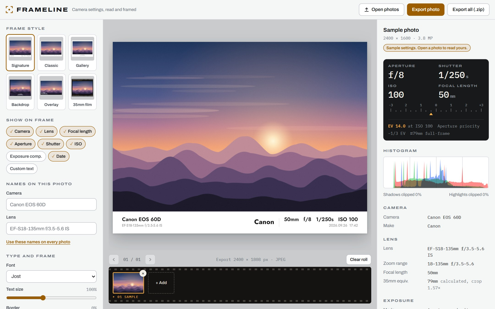
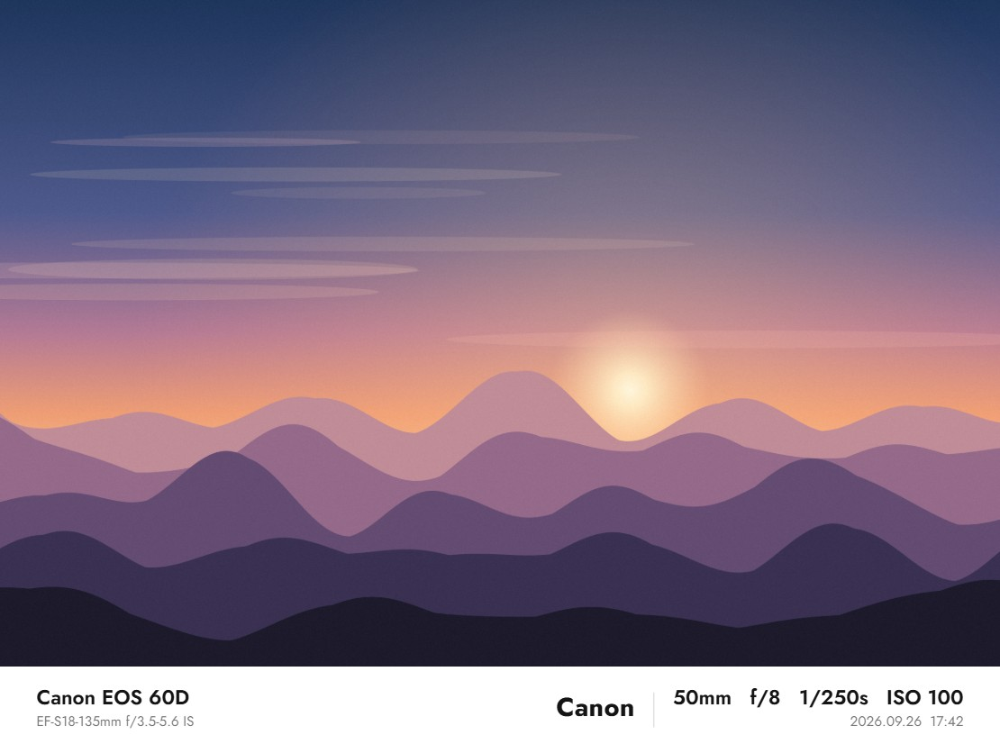
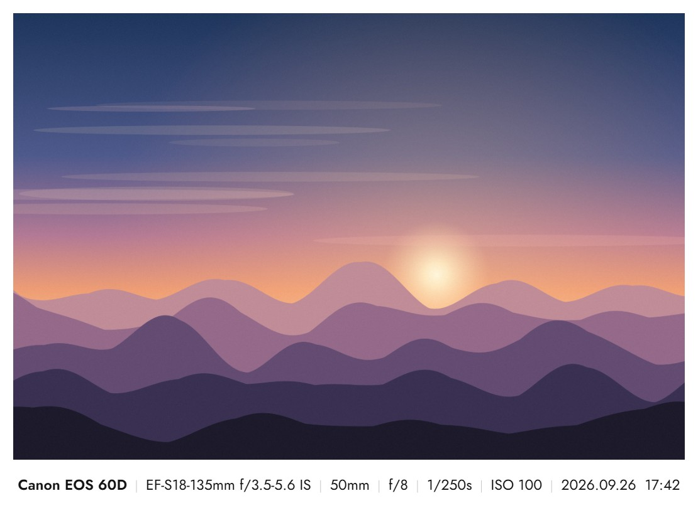
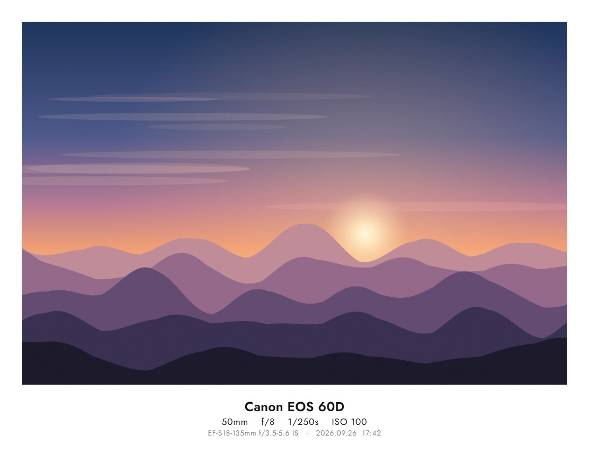
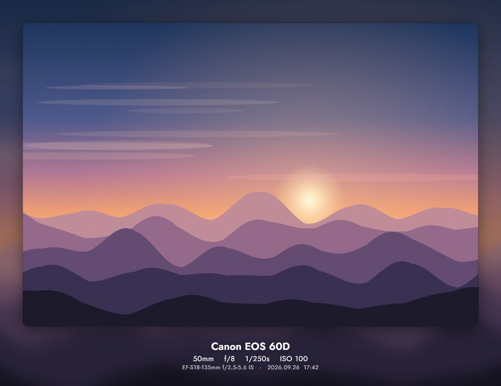
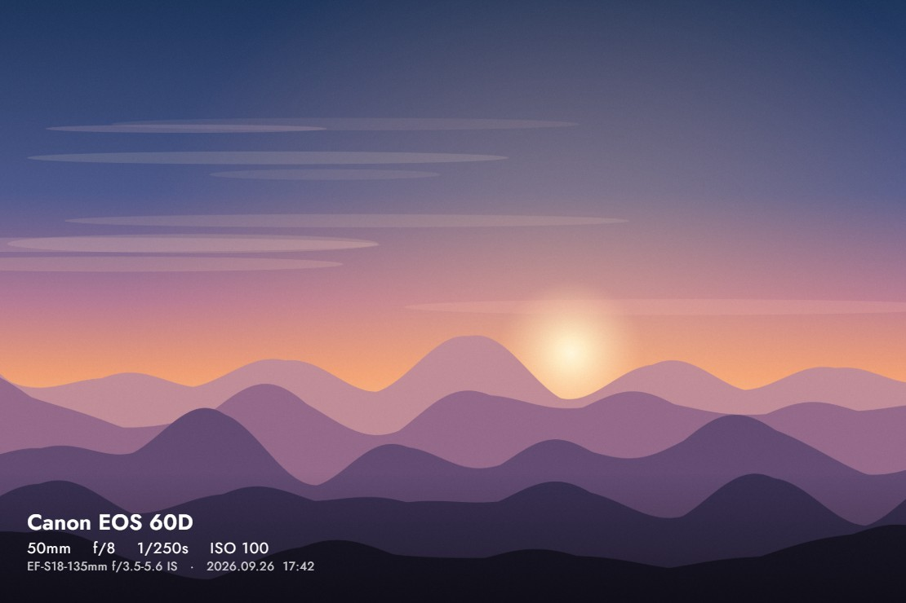
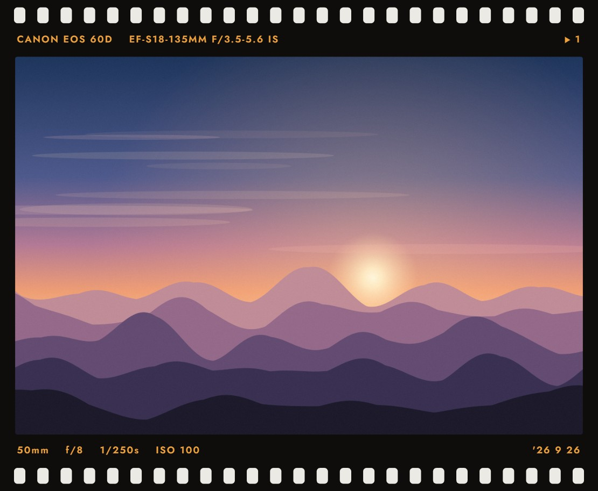
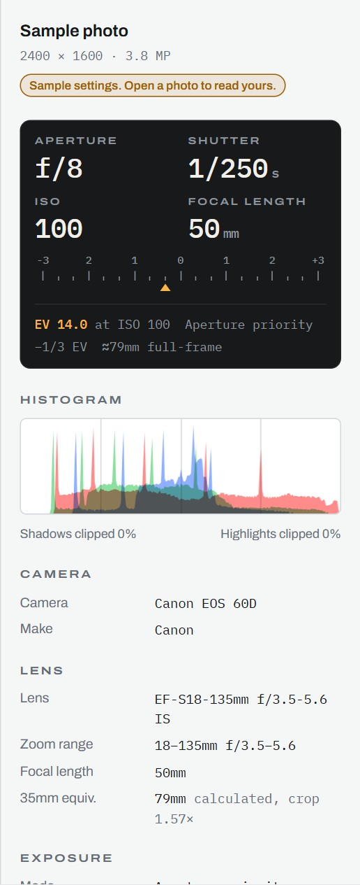
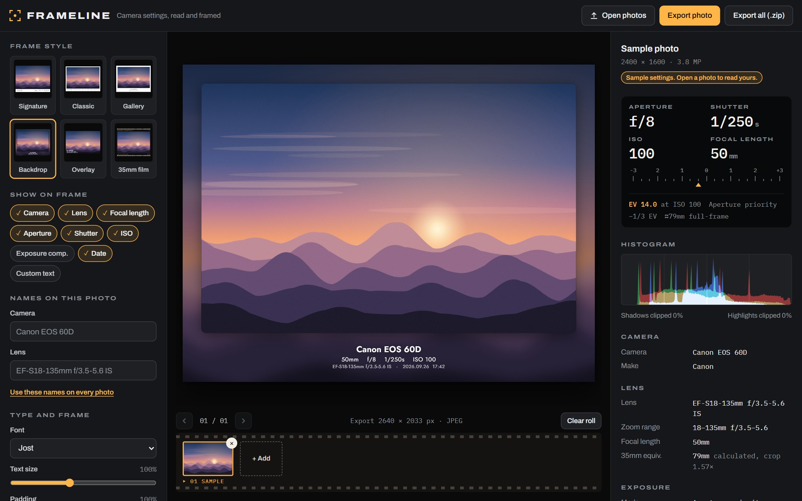
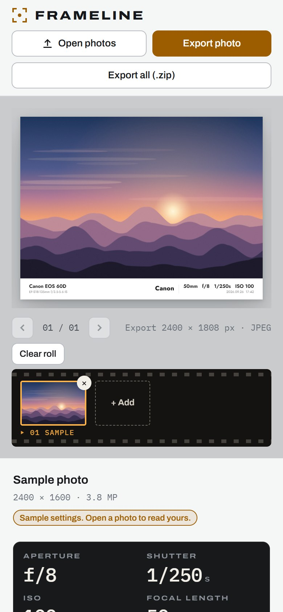

# Frameline

Frameline reads the camera settings stored in your photos (camera, lens, aperture, shutter speed, ISO and more) and adds a frame to each photo showing those settings. It all happens in your browser, so your photos are never uploaded.

**Try it:** https://astrostar123.github.io/frameline/

## Frame styles

| Signature | Classic | Gallery |
| :---: | :---: | :---: |
|  |  |  |
| **Backdrop** | **Overlay** | **35mm film** |
|  |  |  |

## What it shows you

- **Camera readout:** aperture, shutter speed, ISO and focal length, styled like a camera's top screen
- **Exposure compensation scale** from −3 to +3, plus the exposure value (EV)
- **35mm equivalent focal length:** worked out from the sensor size when the camera doesn't record it
- **RGB histogram** showing how much of the shadows and highlights are clipped
- Lens, shooting mode, metering, flash, white balance, date taken, GPS location with a map link, file details
- **Every tag in the file**, in a list you can search

 

## Features

- Six frame styles, with 9 fonts, adjustable text size, border and frame colour (white, black, a tint taken from the photo, or your own colour)
- Choose which details appear on the frame, and add your own text such as `© Your Name`
- Change the camera or lens name for one photo, or for every photo at once
- Canvas shapes: fit, same shape as the photo, 1:1, 4:5, 3:2, 16:9, 9:16
- Export as JPEG or PNG at full size, 4096 px, 2048 px or 1080 px
- Open many photos at once, then export them all as one `.zip`
- Tidy camera names: "Canon EOS 60D" instead of "Canon Canon EOS 60D", and Sony codes like `ILCE-7M3` become "α7 III"
- The preview is drawn the same way as the export, so what you see is what you get
- Light and dark themes, and it works on phones

## Dark mode and phone

## How to use

1. Open https://astrostar123.github.io/frameline/ (or download `index.html` and double-click it).
2. Click **Open photos**, or drag photos onto the page.
3. Pick a frame style and the details to show.
4. Click **Export photo**, or **Export all (.zip)** for every photo.

Works with JPEG, PNG, WebP, TIFF and HEIC files. Chrome can't display HEIC, but Frameline still reads its camera settings.

## Privacy

Photos stay on your computer. Exported images don't carry the original EXIF or GPS data, so your location isn't shared when you post them.

## Built with

- [exifr](https://github.com/MikeKovarik/exifr) for reading EXIF, XMP and GPS data
- [JSZip](https://stuk.github.io/jszip/) for the "Export all" zip file
- Fonts from [Google Fonts](https://fonts.google.com/)

It's one `index.html` file of plain HTML, CSS and JavaScript, with no build step.
